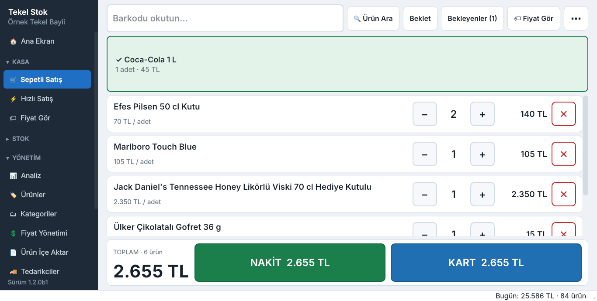
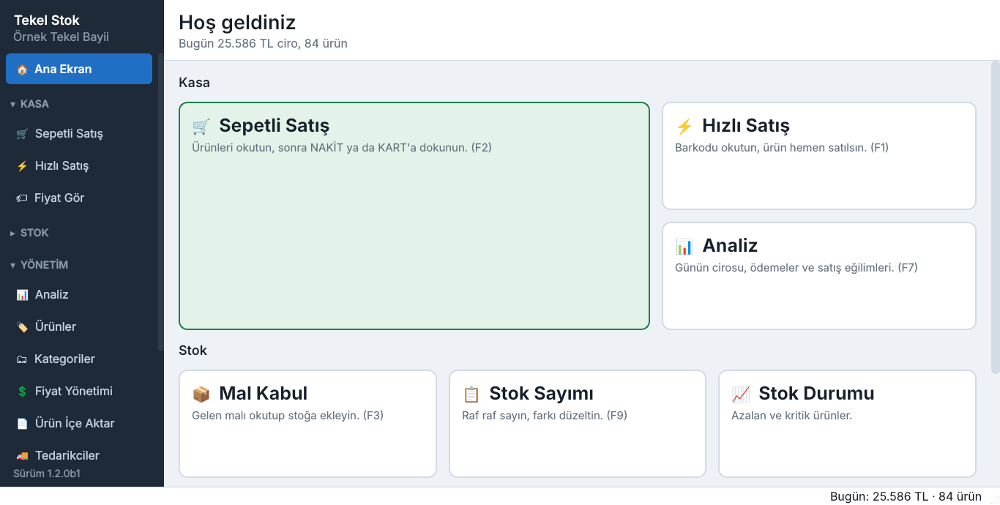
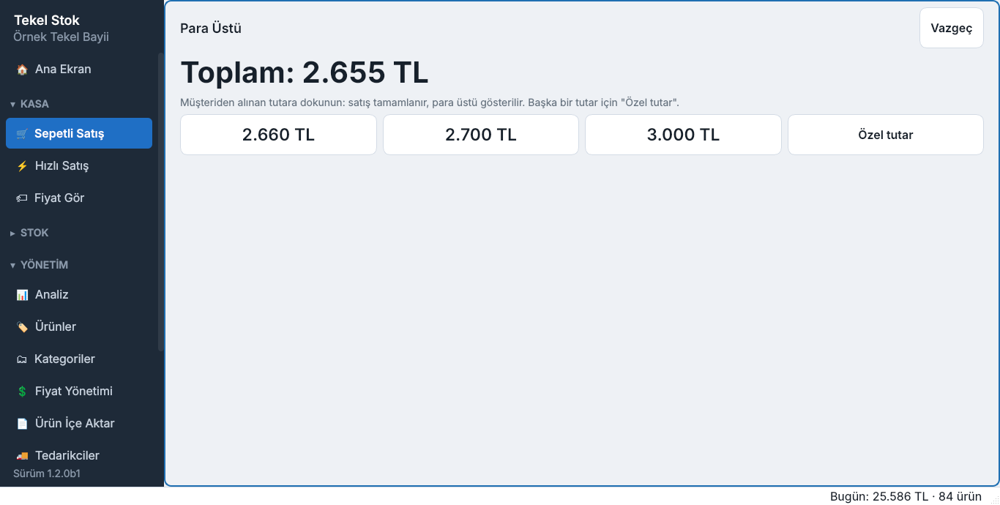
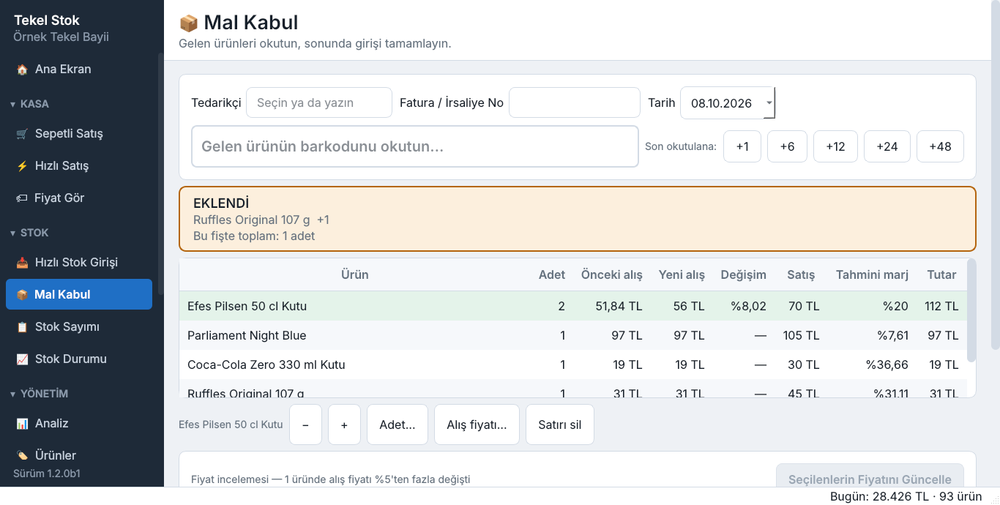
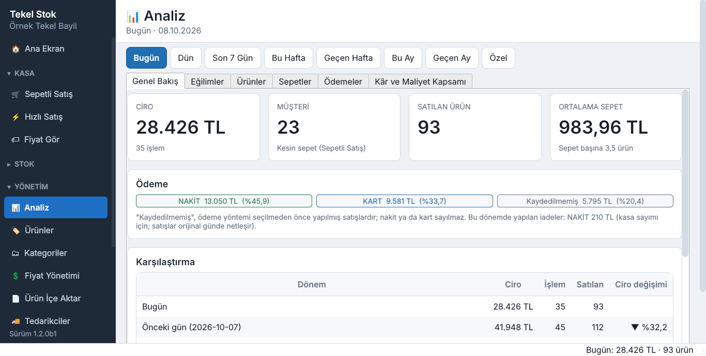
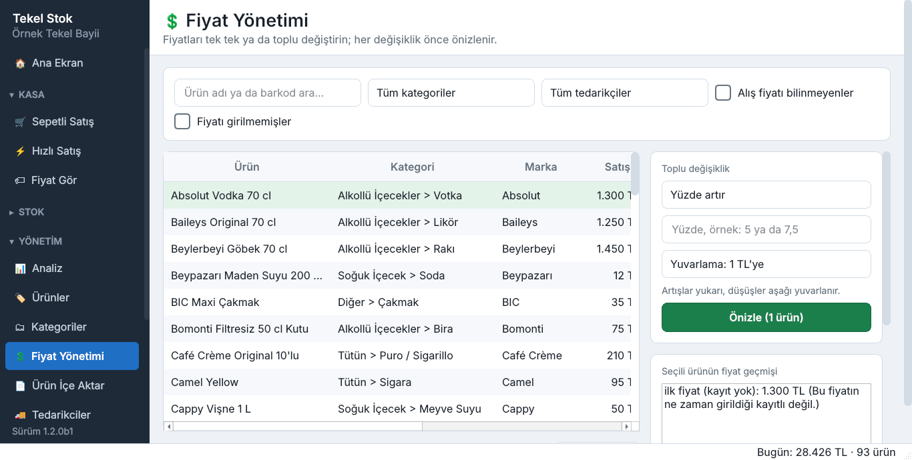

# Tekel Stok

**An offline point-of-sale (POS) and inventory app for a small Turkish liquor, tobacco and snack shop (tekel bayi).**
Barcode sales with a cart, stock receiving, stock counts, price management and sales analytics. Windows desktop,
fully in Turkish, works on a touchscreen till or a normal PC, and needs no internet.

Python 3.12 · PySide6 (Qt) · SQLite (WAL) · openpyxl · pytest · PyInstaller &nbsp;|&nbsp; Version 1.2.0 beta &nbsp;|&nbsp; UI in Turkish



## Features

- **Till:** cart sales with cash / card buttons and a change calculator, quick one-scan sales, parked carts,
  price lookup, on-screen keyboard for touchscreen tills
- **Stock:** goods receiving by supplier and invoice with purchase-price change review, stock counts by location,
  stock status with low and critical levels
- **Management:** products with several barcodes and case sizes, categories, bulk price changes with a preview,
  Excel product import with a preview, suppliers, full history
- **Analytics:** turnover, baskets and payments by period with comparison to the previous period; hourly and weekly
  trends; best and slow sellers; products bought together; profit with a cost-coverage measure
- **Safety:** manager PIN for sensitive actions, automatic backups, a system status page, a barcode-scanner test screen

| | |
|---|---|
|  |  |
| **Home:** the till, stock and management sections | **Payment:** change calculator with quick amounts |
|  |  |
| **Goods receipt:** scan incoming goods; price changes are flagged | **Analytics:** turnover, baskets, payment split |
|  | |
| **Price management:** bulk changes are previewed first | |

*Screenshots come from the built-in screenshot tool with a generated sample shop ("Örnek Tekel Bayii").*

## Technical highlights

```
UI (app/ui)                    draws only, never writes SQL
   ↓
Services (app/services)        business rules, one transaction per operation
Analytics, importers
   ↓
Core (app/core)                database, schema and migrations, money, costing, Turkish text
   ↓
SQLite (WAL)
```

- **Qt-free core:** `core`, `services`, `analytics`, `importers` and the scanner core never import PySide6;
  architecture tests check this.
- **Stock ledger** as the single source of truth; the current-stock column is a cache that can be rebuilt.
- **Money as integer kuruş**, a moving-average cost engine, and costs marked *estimated* instead of silently set to 0.
- **Barcode scanner handling:** a 120 ms double-scan window, scans are never queued behind an open dialog, leading
  zeros are kept, and GTINs are merged only when the check digit is valid.
- **Safe migrations:** additive only, all pending versions in one transaction, a backup and a disk-space check
  first. Fixture databases from v1.0 and v1.1 are tested on every run.
- **Performance tested** on a generated 3-year, 100,000-sale dataset: startup fell from ~3.7 s to ~0.6 s after
  fixes ([report](docs/V1.2_PERFORMANCE.md)).
- **~1,000 automated tests** (pytest) for ~31,000 lines of application code.
- **Developer tools refuse to touch real shop data:** the sample-data, benchmark and screenshot tools only run in a
  scratch folder.
- **Planned and documented:** master plan, execution log, traceability and screen review in [docs/](docs/).

## Running it

```bash
py -3.12 -m venv .venv
.venv\Scripts\python.exe -m pip install -r requirements.txt
.venv\Scripts\python.exe -m app.main --data-dir C:\scratch\data   # start with a scratch data folder
.venv\Scripts\python.exe -m pytest tests                          # run the tests
.venv\Scripts\python.exe build_exe.py --out TekelStok-1.2.0b1      # build the Windows .exe
```

The full user guide (in Turkish) is in [docs/KULLANIM_KILAVUZU.md](docs/KULLANIM_KILAVUZU.md).

## How it was built

I built this app with an AI coding assistant, **Claude** (Anthropic), using Claude Code. My part was the product
work: defining what a small tekel shop needs, deciding the features and their order, testing each version and
approving releases. Claude wrote the code to that specification, in planned phases with written acceptance checks.

---

## Türkçe

**Tekel Stok**, küçük bir tekel bayisi için barkodlu satış (POS) ve stok uygulaması. İnternetsiz çalışır, tamamen
Türkçe, dokunmatik kasada ve normal bilgisayarda kullanılır.

- **Özellikler:** sepetli ve hızlı satış, para üstü hesabı, mal kabul, stok sayımı, stok durumu, toplu fiyat değişikliği
  (önizlemeli), Excel'den ürün aktarma, satış analizi (eğilimler, birlikte alınan ürünler, ödeme dağılımı, kâr),
  yönetici PIN'i, otomatik yedekleme.
- **Teknik:** Python 3.12, PySide6 (Qt), SQLite (WAL), katmanlı mimari (iş mantığı arayüzden bağımsız), stok defteri,
  tam sayı kuruş ve ortalama maliyet hesabı, güvenli şema göçleri, 100.000 satışlık veriyle başarım testi,
  yaklaşık 1.000 otomatik test.
- **Rolüm:** dükkânın ihtiyaçlarını belirledim, özellikleri ve sırasını planladım, her sürümü test edip onayladım.
  Kodu yönlendirmemle yapay zekâ yardımcısı **Claude** (Anthropic) yazdı.
